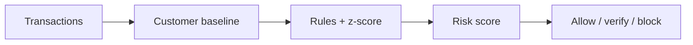

# Fraud Transaction Flagger

> Rules catch the known patterns; per-customer statistics catch the strange ones.

     

**Sector:** Fintech & Risk  ·  **Project 7 of 50** in my [AI Automation Projects series](https://github.com/Princewill106/Princewill106)

## The problem

Fraud teams drown in alerts from rigid thresholds that ignore who the customer is. A NGN 500,000 transfer is normal for one customer and alarming for another, and a block with no explanation is useless to the analyst who has to review it.

## How it works



1. **Baseline** — Build each customer's normal spending profile (mean and spread of amounts, usual devices) from history.
2. **Rules** — Velocity (many transactions in 10 minutes), new device, 1am–5am activity and first-time beneficiary each add risk points.
3. **Anomaly** — A z-score compares the amount to the customer's own history, so 'large' is relative to them.
4. **Route** — Total risk maps to ALLOW, STEP-UP (OTP or call) or BLOCK, with every contributing reason listed.

## Features

- Per-customer amount baselines
- Velocity, device, time-of-day and beneficiary rules
- Explainable risk points per reason
- Three-way routing
- Configurable thresholds

## Quick start

```bash
git clone https://github.com/Princewill106/fraud-transaction-flagger.git
cd fraud-transaction-flagger
python main.py --demo
```

No installs needed: it uses only the Python standard library. The demo runs fully offline using the sample data in this repo.

**Optional: plug in an LLM.** Copy `.env.example` to `.env` and add an Anthropic or OpenAI key. The project will then use the model for the language-heavy steps and fall back to its rule-based logic if a call fails.

Run the tests:

```bash
python -m unittest -v
```

## Sample output

```text
2026-10-01T11:00:00  C001   NGN     21,000  risk   0  ALLOW
2026-10-01T11:05:00  C002   NGN    510,000  risk   0  ALLOW
2026-10-02T02:14:00  C001   NGN    350,000  risk  90  BLOCK
      - amount is 96.9 sd above this customer's normal
      - new device android-z9
      - first transfer to crypto-otc
      - unusual hour 02:14
2026-10-02T02:16:00  C001   NGN     40,000  risk  90  BLOCK
      - amount is 5.9 sd above this customer's normal
      - new device android-z9
      - first transfer to crypto-otc
      - unusual hour 02:16
2026-10-02T02:17:00  C001   NGN     40,000  risk  90  BLOCK
      - amount is 5.9 sd above this customer's normal
      - new device android-z9
      - first transfer to crypto-otc
      - unusual hour 02:17
2026-10-02T02:19:00  C001   NGN     40,000  risk 115  BLOCK
      - amount is 5.9 sd above this customer's normal
      - new device android-z9
      - first transfer to crypto-otc
      - unusual hour 02:19
      - 4 transactions in 10 minutes
2026-10-02T15:00:00  C003   NGN     60,000  risk  30  ALLOW
      - no history for customer

{'ALLOW': 3, 'STEP-UP': 0, 'BLOCK': 4}
```

## Use it in n8n (no code needed)

[`n8n-workflow.json`](n8n-workflow.json) is a ready-to-import n8n version of this project, built for n8n 1.x.

1. In n8n, open **Workflows → Import from File** and choose `n8n-workflow.json`.
2. Click **Test workflow**. It runs the full logic on the sample data built into the *Sample data* node, so you can see the results before connecting anything.
3. Open each output node and connect your accounts: Slack. For Google Sheets, pick your spreadsheet and sheet.
4. Adjust the settings at the top of the **Logic** node (thresholds, templates, contacts), then **Activate**.

**Flow:** **Webhook** (`POST /webhook/score-transaction`) → **Logic** (Code node) → **Route** (Switch)

**Outputs:**
- Alert fraud team (Slack)
- Request OTP (your API)

The Logic node is a JavaScript port of the rules in `main.py`, so you can run the project in n8n without Python.

## Use it on your own data

Provide `history.csv` (past transactions) and `incoming.csv` (to score) with columns `customer,timestamp,amount,device,beneficiary` and run `python main.py`.

## Project structure

```text
n8n-workflow.json            Importable n8n workflow
.env.example                 Optional API key settings
.gitignore                   Git ignore rules
LICENSE                      MIT license
README.md                    This file
llm.py                       Optional LLM helper (offline fallback)
main.py                      Entry point and core logic
requirements.txt             Dependencies (stdlib only)
sample_history.csv           Sample input data for the demo
sample_incoming.csv          Sample input data for the demo
test_main.py                 Unit tests
```

## Who this is for

- Wallet and payment startups
- Bank fraud operations
- Students learning practical anomaly detection

## Ideas to extend it

- [ ] Isolation Forest model alongside rules
- [ ] Feedback loop from analyst decisions
- [ ] Real-time scoring API
- [ ] Geo-velocity rule (impossible travel)

## About

Built by **Ogbu Ugochukwu Princewill**, AI Automation Lead and robotics engineer. I teach people and businesses to build with AI, not just talk about it. [LinkedIn](https://www.linkedin.com/in/ugochukwu-ogbu-653a0816a)

If this helped you, give it a ⭐ and share what you built with it.

## License

MIT — see [LICENSE](LICENSE).
